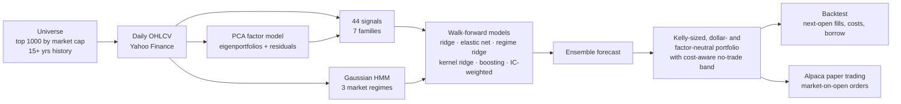

# Quant-Trading

A statistical-arbitrage research and trading system built on the principles
Renaissance Technologies is publicly known for: **many weak signals, hidden
Markov regimes, market-neutral portfolios, short holding periods, and
ruthless out-of-sample testing.** It backtests on the 1,000 largest US
companies with 15+ years of trading history, and paper-trades the same logic
on Alpaca.

> Renaissance has never published its methods. This project is built from
> what is public (interviews, former employees, Zuckerman's *The Man Who
> Solved the Market*, and the academic literature on each technique). It is a
> serious research framework, not a copy of the Medallion Fund.



## Quick start

**No install (GitHub Actions).** Everything runs in the cloud:

1. **Actions → backtest → Run workflow.** It downloads the data, selects
   the universe, runs the full walk-forward backtest, and attaches an HTML
   report to the run as `backtest-report`. A full run takes about an hour.
2. **Actions → tests** runs automatically on every push. It runs the unit
   tests and a demo on a synthetic market.
3. Paper trading: see [Paper trading](#paper-trading) below.

**On your own computer** (Python 3.10+):

```bash
pip install -r requirements.txt
python -m qtrade demo                 # synthetic market, no internet needed (~1 min)
python -m qtrade universe             # pick the 1000-company universe (~5 min)
python -m qtrade backtest             # full backtest -> reports/report.html
python -m qtrade paper                # paper-trading dry run (prints orders)
python -m qtrade signals              # list the signal library
python -m pytest                      # the test suite
```

Useful flags: `--size 300` (smaller universe, much faster), `--start 2010-01-01`,
`--models ridge,ic_weighted`, `--horizon 1`, `--config my.yaml`.
Every tunable number lives in [`config/default.yaml`](config/default.yaml).

## How it works

The math is written out in detail in [`docs/MATH.md`](docs/MATH.md).

### 1. Universe
The universe is taken from the iShares Russell 3000 ETF holdings, ranked by
market value. The system walks down that list and keeps each company whose
first trading day is at least 15 years ago, stopping at 1,000 companies.
On any given day, a stock is tradable only if it is above $5, has at least
$5M of daily dollar volume, and has a year of price history.

### 2. Statistical factor model
Every month, PCA on the last 252 days of returns gives 15 *eigenportfolios*
(Avellaneda & Lee, 2010). Each stock's return splits into a factor part and a
**residual**: the idiosyncratic move a stat-arb book tries to predict.
K-means on the factor loadings groups stocks into data-driven peer clusters.

### 3. Signals: 44 weak predictors in 7 families

| Family | Signals |
|---|---|
| **mean reversion** | `rev_1d`, `rev_5d`, `rev_21d`, `resid_rev_1d`, `resid_rev_5d`, `ou_sscore`, `bollinger_z`, `rsi_14`, `overnight_rev`, `intraday_rev`, `low_volume_rev` |
| **momentum** | `mom_12_1`, `mom_6_1`, `resid_mom`, `high_52w`, `trend_quality`, `mom_accel`, `overnight_mom`, `intraday_rev_21`, `cluster_mom` |
| **volume** | `abn_volume`, `amihud`, `turnover_trend`, `vol_price_corr`, `size_proxy` |
| **volatility** | `low_vol`, `idio_vol`, `max_effect`, `neg_skew`, `bab`, `downside_beta`, `vol_of_vol` |
| **microstructure** | `range_vol_ratio`, `close_location`, `cs_spread`, `gk_ratio` |
| **seasonality** | `same_month`, `weekday_seasonality`, `turn_of_month` |
| **structure** | `peer_gap`, `peer_lead`, `kalman_trend`, `autocorr_signal`, `market_corr` |

Each signal is winsorized and z-scored across stocks every day. The models
learn their weights, so a signal that has stopped working is simply
down-weighted. Adding a signal is one decorated function in
[`qtrade/signals/library.py`](qtrade/signals/library.py).

### 4. Hidden Markov regimes
A Gaussian HMM, written from scratch with Baum–Welch and forward filtering,
reads four market symptoms: 5-day market return, realized volatility,
cross-sectional dispersion, and correlation. From these it infers the
probability of being in a *calm*, *normal* or *stressed* regime. Only
**filtered** probabilities are used, meaning ones that look backward only.
On the synthetic market with planted regimes, it recovers the true regime
about 86% of the time.

### 5. Walk-forward models
Six models are refit every quarter on a rolling 5-year window. The target is
next week's return, ranked across stocks:

| Model | Idea |
|---|---|
| `ridge` | linear, penalty chosen on a time-ordered holdout |
| `elastic_net` | linear with L1, which drops useless signals |
| `regime_ridge` | separate signal weights for each HMM regime |
| `kernel_ridge` | random Fourier features approximating Gaussian-kernel regression |
| `gbm` | gradient-boosted trees (nonlinear, with interactions) |
| `ic_weighted` | weights by each signal's information ratio (Grinold) |

The traded forecast is the **ensemble**: the average of the members'
daily z-scores.

### 6. Portfolio construction
- **Expected return** = IC × volatility × score (Grinold). The IC is the
  model's *realized* out-of-sample IC, shrunk toward a prior, so a model that
  stops working is automatically sized down to zero.
- **Kelly-optimal weights subject to zero net dollars and zero exposure to
  every PCA factor.** This has a closed-form solution.
- **Leverage** = the smallest of half-Kelly, a 10% volatility target, and 2×
  gross (the Reg T limit). The per-name cap is 2% of equity.
- **Forecast smoothing** (3-day half-life) filters day-to-day flips in the
  forecast before it is traded.
- **Cost-aware no-trade band.** A position is only traded when the expected
  gain beats spread plus market impact, with costs amortized over how long
  forecasts actually persist.
- **Drawdown brake**: after a 15% drawdown, exposure is halved until half
  the loss is recovered.

### 7. Backtest realism
- Decisions are made at the close, and trades fill at the **next day's open**.
- Costs: a half-spread by liquidity tier, 1 bp slippage, square-root market
  impact, and a 50 bp/yr borrow fee on shorts.
- **Price levels as they traded.** Yahoo back-adjusts every price for later
  splits and dividends, so NVDA's adjusted 2005 price is a few cents. Returns
  use adjusted prices, but the $5 floor, dollar volume (liquidity filter,
  spread tiers, impact, the `size_proxy` and `amihud` signals) and whole-share
  rounding use the close and volume that actually printed that day. Otherwise
  stocks that later split a lot (the big winners) would be dropped from the
  early years, which is a look-ahead. `tests/test_invariants.py` checks that
  re-adjusting a stock's history for a later split or dividend changes no
  signal, filter or trade.
- **No look-ahead, enforced by tests.** Every signal, the regime
  probabilities, and every model forecast are recomputed on history cut off
  at day *D*, and must exactly match the full-history values at *D*.
- **Deflated Sharpe ratio** (Bailey & López de Prado). It reports the
  probability that the edge is real after correcting for having tried six
  models plus the ensemble.

## Results on real data

Full backtest: 1,000 stocks, December 2003 to October 2026, all six models,
run in GitHub Actions. Every run is published to the
[`results` branch](../../tree/results), with charts, tables and a
dated history.

**The forecasts are real.** Every model has a positive out-of-sample rank IC
(about 0.01 to 0.014). The strongest signals are residual reversal,
peer-gap, and weekly reversal, with t-stats of 10 to 13. With *zero*
trading costs, the ensemble earns:

| Forecast horizon | Frictionless Sharpe, 2004–2026 | 2004–2014 | 2015–2026 |
|---|---|---|---|
| 1 day | 1.88 | 2.93 | 1.06 |
| 5 days | 1.51 | 2.61 | 0.73 |
| 20 days | 0.75 | 1.09 | 0.60 |

**After realistic costs, no setting has a tradable edge.** The alpha lives in
1–2 day reversals, so capturing it means turning the book over 250–500× a
year. Spread, impact, and borrow costs then exceed the profit. The no-trade
band and forecast smoothing cut turnover to 10–30×, but they remove the
alpha almost as fast as the costs.

Settings were chosen honestly: the best combination of horizon × smoothing ×
cost aversion was picked **on 2004–2014 only**, then judged on 2015–2026.

| | 2004–2014 (selection) | 2015–2026 (unseen) |
|---|---|---|
| Chosen: 5-day horizon, 3-day smoothing, cost aversion 1.0 | Sharpe **+0.29** | Sharpe **−0.58** |

That configuration is the default, and it is what paper trading runs. It
loses money out of sample. That matches what is publicly known: short-term
reversal profits in large US stocks have shrunk sharply since the 2000s, and
the firms that still harvest them do so with intraday data and execution far
cheaper than a daily-bar model can assume.

**What would most plausibly change the answer:**
1. **Cheaper execution.** The edge per unit of turnover is about 2–3 bp. Trading
   only the most liquid names, or using a cost model calibrated to real fills
   (opening-auction orders often pay less than half the quoted spread), could
   flip the sign. Paper-trade fills give a first read on true costs.
2. **Intraday data.** Reversal alpha that decays within a day needs intraday
   bars to capture before it's gone.
3. **Slower, orthogonal signals.** Fundamentals, earnings revisions, and
   analyst data feed alphas that live for months and survive costs.

## Read the results honestly

- **Survivorship bias.** Picking *today's* large, long-lived companies and
  testing them over the past means the backtest never holds a company that
  went bankrupt or shrank. This flatters results. A bias-free test would need
  historical index membership, which isn't freely available.
- **Free data.** Yahoo prices are good but not institutional grade, and opening
  prices in particular can be noisy.
- **Leverage sets the return.** Sharpe ratio measures skill, while leverage
  sets the size of returns. A diversified 1,000-stock market-neutral book at
  2× gross has low volatility (a few percent a year). Medallion reportedly ran
  far higher leverage than a retail account is allowed.
- A good backtest is a reason to paper trade, not to trade real money.

## Small accounts ($10k)

[`config/small_account.yaml`](config/small_account.yaml) adapts the system to
a $10,000 account. A 1,000-name book would mean about $20 per stock, so instead:

- it holds about 60 names (30 long, 30 short), opening positions only in the
  strongest signals and keeping a position while it stays in the top or bottom
  60;
- every position is a **whole number of shares**: Alpaca doesn't allow
  fractional shares in short sales or opening-auction orders;
- it hedges only the market and the two strongest PCA factors, since 15
  hedges are too many for 60 names;
- costs assume **market-on-open orders**. These trade at the single auction
  price, so there is no bid-ask spread to cross, just 1.5 bp of slippage.
  Market impact at $10k is negligible.

**Backtest, 2003–2026, 60 names, $10k, auction costs:**

| | Net Sharpe | Return / yr | Volatility | Max drawdown |
|---|---|---|---|---|
| Full period | 0.41 | 3.3% | 8.0% | −24% |
| 2004–2014 | 0.79 | | | |
| 2015–2026 | 0.01 | | | |

The full-period deflated Sharpe probability is 91%, short of the usual 95% bar.
The result depends on the no-spread assumption: charging quoted spreads
instead takes the full-period Sharpe to −0.09. And all of the profit came
before 2015.

```bash
python -m qtrade --config config/small_account.yaml backtest
python -m qtrade --config config/small_account.yaml paper
```

The config also caps paper trading at $10k (`live.max_capital`), even though
Alpaca paper accounts start at $100k. The scheduled paper trades use this
config by default. To trade the full 1,000-name book instead, set a
repository variable `QTRADE_CONFIG` = `config/default.yaml`
(Settings → Secrets and variables → Actions → Variables).

## Research data

**Results to share:** [`research_data/`](research_data/README.md) has every
research output (signal and model correlations, strategy returns, backtests)
as CSV and Markdown, refreshed with `bash scripts/export_research_data.sh`.
SEC fundamentals, insider trades and S&P 500 changes are published
unencrypted in the release **public-data**.

Four datasets beyond daily prices are kept in the GitHub release **data**.
Each is a tar archive split into 1.9 GB parts, because GitHub caps release
files at 2 GB. A manifest of what each contains (symbols, row counts, date
ranges) is published to `datasets/` on the `results` branch.

**The archives are encrypted.** This repository is public, but exchange market
data and Benzinga news are licensed for personal use only, so they must not be
redistributed. Every archive is encrypted with AES-256 using the `DATA_KEY`
repository secret before upload. To unpack one on your own computer:

```bash
export DATA_KEY='...your key...'
cat intraday_5min.tar.enc.part* | openssl enc -d -aes-256-cbc -pbkdf2 -iter 200000 -pass env:DATA_KEY | tar -x -C data
```

| Dataset | Source | Coverage | Refreshed |
|---|---|---|---|
| `intraday_5min` | Alpaca (free plan, all US exchanges) | 5-minute bars, 1000 stocks, 2016→ | weekly |
| `intraday_1min` | Alpaca | 1-minute bars, 200 most liquid stocks, 2016→ | weekly |
| `news` | Alpaca news API (Benzinga) | headlines and summaries tagging the universe, 2015→ | weekly |
| `fundamentals` | SEC EDGAR XBRL company facts | ~40 income-statement, balance-sheet and cash-flow items, ~2009→ | monthly |

Bars are regular hours only (09:30–16:00 New York time), split- and
dividend-adjusted. Every fundamentals row carries its SEC **filing date**, and
`qtrade.data.fundamentals.point_in_time` only returns numbers that had been
filed by each date, so signals never see earnings before they were announced.
News articles likewise carry their publication time.

**Workflows:**
- **alpaca-data** downloads from a job queue, e.g. `bars:5Min:1000 news:1000`
  or `bars:1Min:200`. Alpaca allows about 200 requests a minute, so the big
  downloads take many hours. Each run stops before GitHub's 6-hour limit,
  saves its progress, and re-launches itself with the rest of the queue. On
  Saturdays it appends the latest week to every dataset that exists.
- **fundamentals-data** downloads from the SEC, monthly. The SEC requires a
  name and email: add them as a repository **secret** (not a variable, which
  would be printed in the public logs) named `SEC_USER_AGENT`, e.g.
  `Your Name you@example.com`.
- **encrypt-data** re-packs all stored datasets with the current `DATA_KEY`.
  Run it after changing the key.

**Locally:** `python -m qtrade intraday --timeframe 5Min --symbols 1000`,
`python -m qtrade news`, `python -m qtrade fundamentals`. Then load with
`qtrade.data.intraday.load_panel`, `qtrade.data.news.load_news` and
`qtrade.data.fundamentals.load_fundamentals`.

## Intraday trading (every 5 minutes)

A second strategy, in [`qtrade/intraday/`](qtrade/intraday), trades the same
idea (short-term reversal) at a much faster clock, on the 5-minute bars in the
`intraday_5min` dataset:

- **Signals**, recomputed at every bar for the 500 most liquid stocks: minus
  the last 5, 15 and 60 minutes' return relative to the other stocks, the
  return since the open, the overnight gap, distance from today's VWAP, and
  abnormal volume (reversals on light volume are stronger). Each is scaled by
  the stock's own 5-minute volatility and weighted separately for the open,
  midday and the close.
- **Model**: ridge regression forecasting the next 30 minutes, refit every
  month on the previous 12 (walk-forward).
- **Trading**: decide at a bar's close, fill at the next bar's open. 20 longs
  and 20 shorts, dollar-neutral, 2x gross, with the same cost-aware no-trade
  band as the daily book. **Flat from 15:45 every day**, so there is no
  overnight risk and no borrow fee.
- **Costs**: every intraday trade crosses the spread (no auction), charged by
  liquidity tier (1-8 bp half-spread) plus slippage and square-root impact.
  The report also shows half and double costs, and trading every 15, 30 and 60
  minutes instead of every 5.

**Backtest:** Actions -> **intraday-backtest** -> Run workflow (needs the
`DATA_KEY` secret). The report and the trained `model.json` go to
`intraday/` on the `results` branch. Locally:
`python -m qtrade intraday-backtest --store data/intraday/5min`, or
`--synthetic` for an offline check.

**Which trader runs.** Only one strategy may own the paper account, chosen by
the repository **variable** `TRADING_MODE`:

| `TRADING_MODE` | Workflow | What it does |
|---|---|---|
| `auction` (default) | **auction-trade** | market-on-close book at ~15:45 (fade the 15:15-15:45 move + past month's overnight returns), closed with market-on-open orders the next morning; logs every fill against the official open / close |
| `intraday` | **intraday-trade** | rebalances every 5 minutes, flat by 15:45 |
| `daily` | **paper-trade** | the daily stock book + ETF sleeves, market-on-open |

The auction trader is the default because auction orders pay no spread: of
everything tested, its two strategies are the only intraday-style trades whose
edge survives costs (`research_data/ibkr/intraday_edge_ibkr_no_trades.xlsx`),
and only if auction fills cost close to 0 bp, which its fill log measures.

**Paper trading (intraday):** Actions -> **intraday-trade** -> Run workflow (dry run by
default), or set `TRADING_MODE` = `intraday` to run it every day. It uses the intraday
model zoo's winner (`intraday/zoo/model_zoo.joblib`, retrained monthly) when
one exists, otherwise the production ridge. It waits
for the open, rebalances a few seconds after every 5-minute bar using
Alpaca's free real-time (IEX) feed, and closes everything at 15:45. A GitHub
job can only run 6 hours, so it hands over to a follow-up run mid-afternoon.

> **Pattern-day-trader rule.** US brokers only allow unlimited day trading in
> margin accounts with at least **$25,000** of equity. Alpaca's paper account
> starts at $100k, so paper trading is fine, but this strategy **cannot be run
> with real money in a $10k account**: it day-trades dozens of times a day.

## Paper trading

1. Create a free account at [alpaca.markets](https://alpaca.markets), switch
   to the **Paper** account, and generate API keys.
2. In this repo: **Settings → Secrets and variables → Actions → New repository
   secret**. Add `ALPACA_API_KEY` and `ALPACA_SECRET_KEY`.
3. **Actions → paper-trade → Run workflow** with `send` unticked does a dry run
   (the orders are in the run's log and artifact). Tick `send` to place them.
4. From then on, the workflow runs automatically every weekday before the open
   and submits market-on-open orders. It is scheduled at about 6:47am New York
   time with a back-up at 8:17am, because GitHub's scheduler sometimes delays
   or drops runs. The back-up skips itself if orders were already sent that day.
5. What it trades: by default `config/multi_small_account.yaml`, $10k split
   half and half between the stock book and seven ETF sleeves
   (`qtrade/portfolio/sleeves.py`: vol-managed SPY, 200-day average, 12-month
   trend, turn of the month, cross-asset momentum, risk parity, multi-asset
   trend). Set the repository variable `QTRADE_CONFIG` to
   `config/small_account.yaml` to trade the stock book alone.

**Tracking performance:** the **paper-status** workflow reads the account
after each close and records the day's P&L (on the $10k traded and on the
whole account), exposure and positions in `paper/` on the `results` branch,
with one row per day in `paper/history.csv`. Run it from the Actions tab for
an intraday snapshot.

Locally: `export ALPACA_API_KEY=... ALPACA_SECRET_KEY=...`, then
`python -m qtrade paper` (dry run) or `python -m qtrade paper --send`.

The client is hard-wired to Alpaca's **paper** endpoint. Shorts are only
placed in names Alpaca marks easy to borrow. A position that would flip from
long to short is closed one day and reopened the next. Every run writes
`targets_*.csv` and `orders_*.csv` to `logs/`.

## Project layout

```
qtrade/
  data/         universe selection, Yahoo download + cache, synthetic market
  features/     shared panels, PCA eigenportfolio factor model
  signals/      the 44-signal library and registry
  models/       Gaussian HMM, walk-forward regimes, six combiners
  portfolio/    Kelly/neutral optimizer, no-trade band, shared daily decision
  backtest/     engine, cost model, metrics (PSR/DSR), HTML report
  live/         Alpaca paper trader
  intraday/     5-minute reversal strategy: features, walk-forward model, backtest, live loop
  pipeline.py   data -> signals -> regimes -> forecasts
  cli.py        python -m qtrade ...
tests/          no-look-ahead, HMM recovery, neutrality, accounting, orders
config/         default.yaml with every parameter
docs/MATH.md    the mathematics, step by step
```

## References

- Avellaneda & Lee (2010), *Statistical arbitrage in the US equities market*
- Baum, Petrie, Soules & Weiss (1970), the Baum–Welch algorithm; Rabiner (1989), *A tutorial on HMMs*
- Grinold & Kahn, *Active Portfolio Management*: the fundamental law, alpha = IC·σ·z
- Gârleanu & Pedersen (2013), *Dynamic trading with predictable returns and transaction costs*
- Rahimi & Recht (2007), *Random features for large-scale kernel machines*
- Bailey & López de Prado (2012, 2014), probabilistic and deflated Sharpe ratios
- Almgren et al. (2005); Tóth et al. (2011): square-root market impact
- Signal sources: Jegadeesh & Titman (1993), Lehmann (1990), Blitz et al. (2011), George & Hwang (2004), Ang et al. (2006),
  Bali et al. (2011), Frazzini & Pedersen (2014), Heston & Sadka (2008), Lou, Polk & Skouras (2019), Amihud (2002),
  Corwin & Schultz (2012), Campbell, Grossman & Wang (1993)
- Zuckerman (2019), *The Man Who Solved the Market*

*Educational research software. Not investment advice.*
