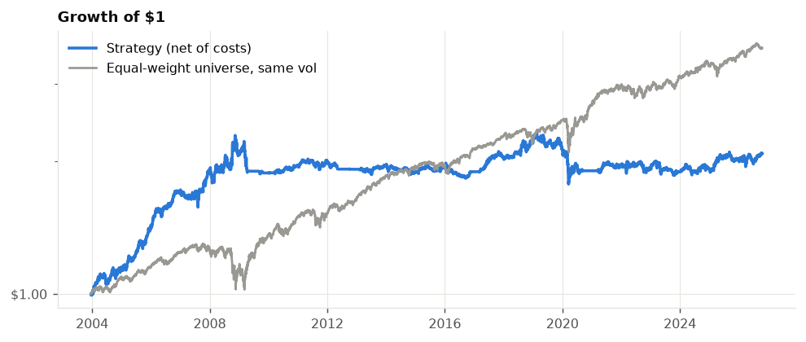
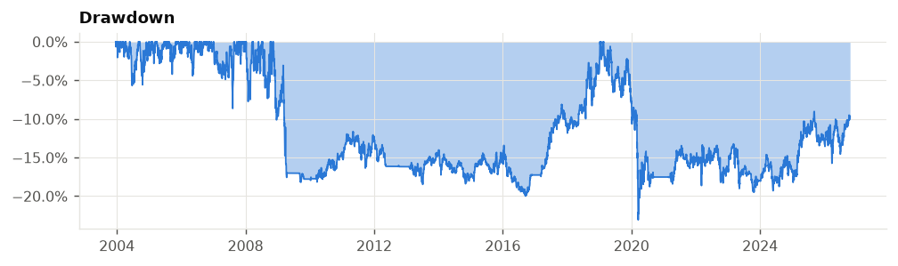
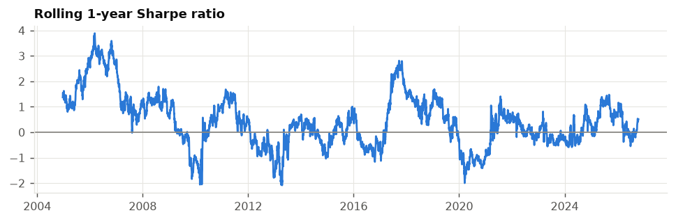
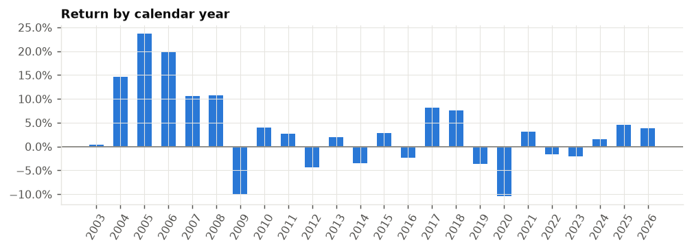
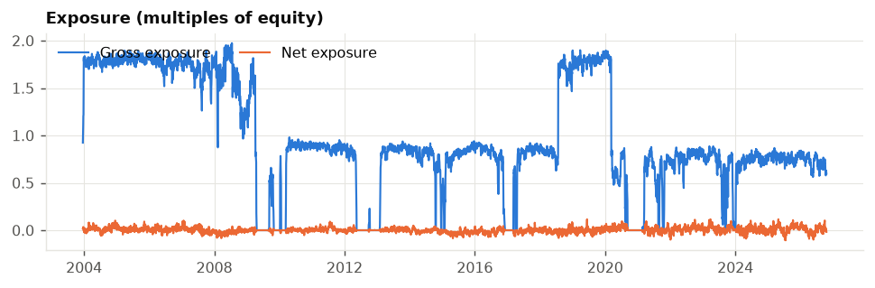
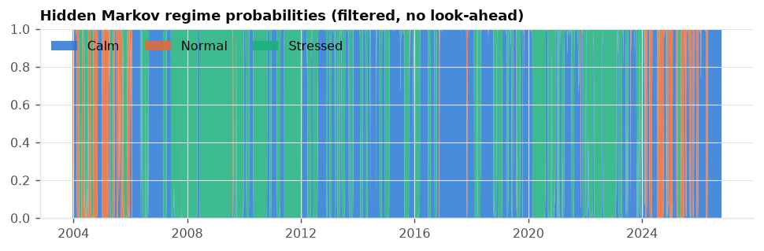
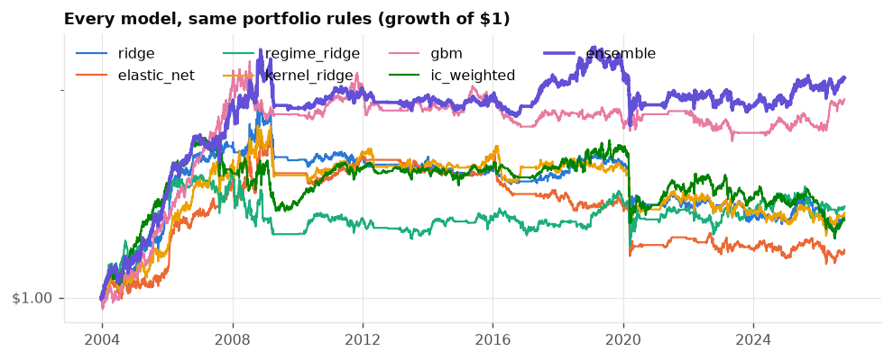
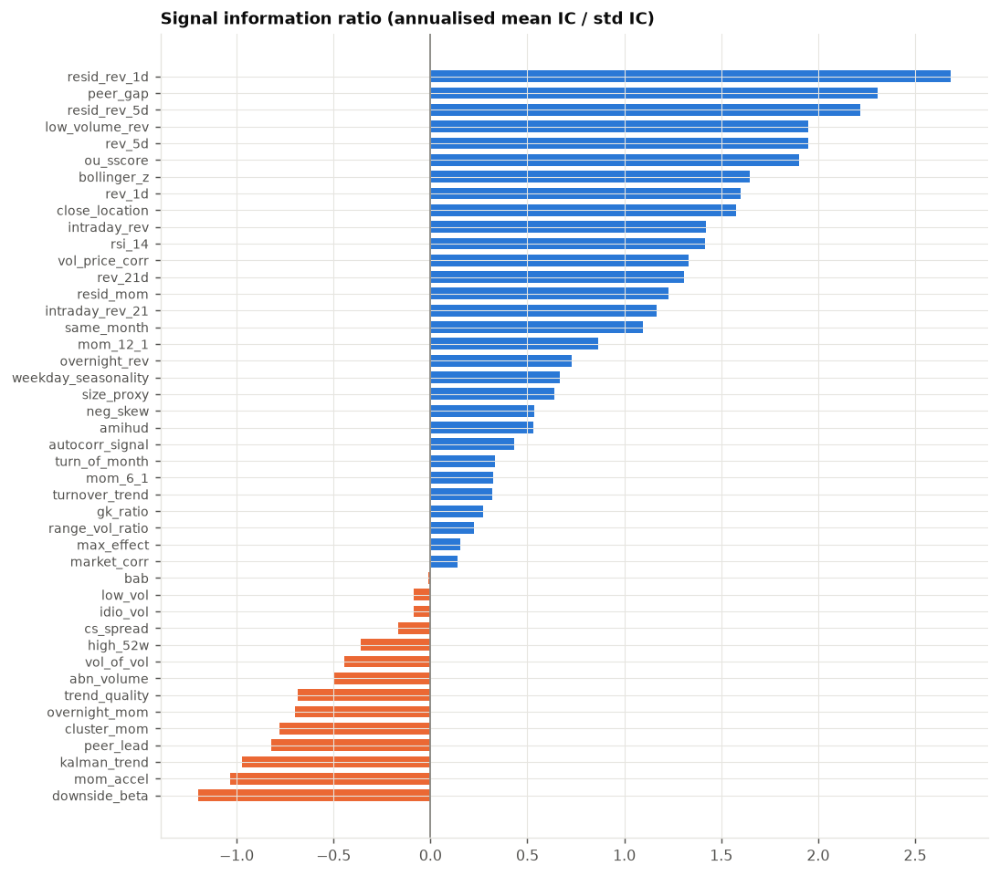
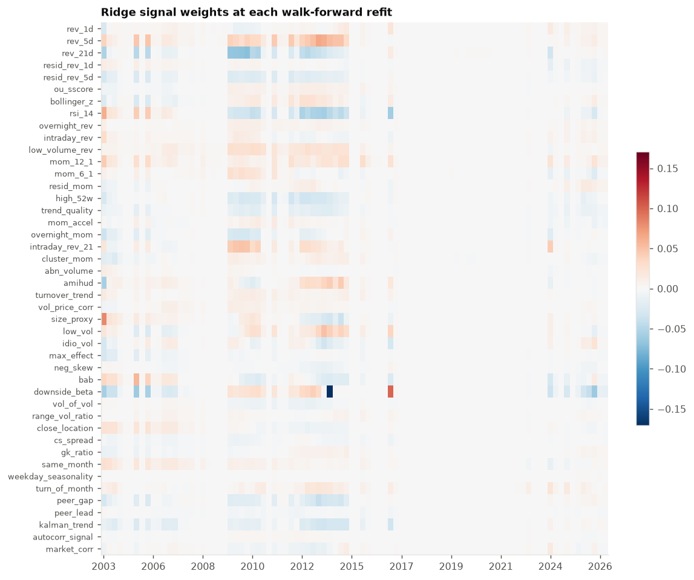

# Backtest results

| | |
|---|---|
| Period | 2003-12-19 to 2026-10-19 (22.8 years) |
| Stocks / signals | 1000 / 44 |
| Traded model | ensemble |
| Sharpe ratio | 0.47 |
| Annual return | 3.5% |
| Annual volatility | 7.5% |
| Max drawdown | -23.1% |
| Deflated Sharpe probability | 90.6% |
| Beta / correlation to market | 0.02 / 0.07 |
| Avg gross exposure | 0.97x |
| Annual turnover | 74x |
| Cost + borrow drag / yr | 1.5% |

> **Read these results with care.** The universe is today's largest companies that have traded for 15+ years, tested over the past - so it never holds a company that later failed or shrank (survivorship and look-ahead bias). Expect live results to be weaker.
>
> Everything else is out-of-sample: signals use only past data, models are refit walk-forward, trades fill at the next day's open, and spread, market impact and borrow fees are charged.
>
> The **deflated Sharpe** is the probability the true Sharpe is above zero after correcting for having tried every model on this page. Below ~95% the edge is not statistically convincing.
>

## Models (same portfolio rules)

| model        |   sharpe |   ann_return |   ann_vol |   max_drawdown |   ann_turnover |   ann_cost_drag |   mean_ic |
|:-------------|---------:|-------------:|----------:|---------------:|---------------:|----------------:|----------:|
| gbm          |    0.485 |        0.031 |     0.064 |         -0.234 |         66.226 |           0.011 |     0.007 |
| ensemble     |    0.468 |        0.035 |     0.075 |         -0.231 |         74.072 |           0.013 |     0.009 |
| regime_ridge |    0.243 |        0.015 |     0.063 |         -0.23  |         59.602 |           0.01  |     0.01  |
| kernel_ridge |    0.212 |        0.015 |     0.07  |         -0.308 |         65.734 |           0.011 |     0.008 |
| ridge        |    0.212 |        0.014 |     0.066 |         -0.351 |         59.029 |           0.01  |     0.005 |
| ic_weighted  |    0.197 |        0.014 |     0.07  |         -0.286 |         85.375 |           0.014 |     0.009 |
| elastic_net  |    0.141 |        0.009 |     0.063 |         -0.36  |         53.795 |           0.009 |     0.006 |

## Portfolio-construction diagnostics (same ensemble forecast)

| variant                        |   sharpe |   sharpe_1st_half |   sharpe_2nd_half |   ann_return |   ann_vol |   pre_cost_sharpe |   avg_gross |   ann_turnover |   cost_drag |
|:-------------------------------|---------:|------------------:|------------------:|-------------:|----------:|------------------:|------------:|---------------:|------------:|
| current config                 |    0.468 |             0.781 |             0.116 |        0.035 |     0.075 |             0.671 |       0.975 |         74.072 |       0.015 |
| frictionless                   |    0.632 |             1.013 |             0.241 |        0.053 |     0.083 |             0.632 |       1.135 |         93.291 |       0     |
| auction_costs (no spread)      |    0.468 |             0.781 |             0.116 |        0.035 |     0.075 |             0.671 |       0.975 |         74.072 |       0.015 |
| quoted_spread_costs            |   -0.069 |             0.079 |            -0.265 |       -0.004 |     0.059 |             0.586 |       0.626 |         45.97  |       0.038 |
| rank_weights                   |    0.4   |             0.707 |             0.027 |        0.03  |     0.075 |             0.578 |       0.853 |         63.989 |       0.013 |
| dollar_neutral_only            |    0.248 |             0.274 |             0.223 |        0.029 |     0.119 |             0.338 |       0.862 |         51.185 |       0.011 |
| regime_ic                      |    0.428 |             0.748 |             0.11  |        0.034 |     0.08  |             0.644 |       1.105 |         84.783 |       0.017 |
| regime_ic + edge_scaling       |    0.394 |             0.602 |             0.109 |        0.023 |     0.057 |             0.599 |       0.729 |         58.944 |       0.012 |
| edge_scaling                   |    0.384 |             0.656 |             0.02  |        0.02  |     0.053 |             0.57  |       0.627 |         49.387 |       0.01  |
| halflife=0 cost_aversion=0.0   |    0.611 |             1.12  |             0.153 |        0.061 |     0.1   |             1.274 |       1.318 |        336.907 |       0.066 |
| halflife=0 cost_aversion=0.25  |    0.627 |             1.121 |             0.18  |        0.061 |     0.098 |             1.252 |       1.262 |        309.632 |       0.061 |
| halflife=0 cost_aversion=0.5   |    0.67  |             1.145 |             0.233 |        0.064 |     0.095 |             1.27  |       1.206 |        287.697 |       0.057 |
| halflife=0 cost_aversion=1.0   |    0.705 |             1.182 |             0.252 |        0.064 |     0.091 |             1.262 |       1.101 |        253.283 |       0.05  |
| halflife=3 cost_aversion=0.0   |    0.513 |             0.847 |             0.169 |        0.041 |     0.08  |             0.742 |       1.091 |         89.855 |       0.018 |
| halflife=3 cost_aversion=0.25  |    0.525 |             0.861 |             0.175 |        0.042 |     0.08  |             0.745 |       1.081 |         85.91  |       0.018 |
| halflife=3 cost_aversion=0.5   |    0.496 |             0.823 |             0.149 |        0.039 |     0.078 |             0.709 |       1.046 |         81.552 |       0.017 |
| halflife=3 cost_aversion=1.0   |    0.468 |             0.781 |             0.116 |        0.035 |     0.075 |             0.671 |       0.975 |         74.072 |       0.015 |
| halflife=7 cost_aversion=0.0   |    0.244 |             0.434 |             0.057 |        0.017 |     0.07  |             0.404 |       0.951 |         52.96  |       0.011 |
| halflife=7 cost_aversion=0.25  |    0.23  |             0.432 |             0.035 |        0.016 |     0.07  |             0.387 |       0.944 |         51.366 |       0.011 |
| halflife=7 cost_aversion=0.5   |    0.238 |             0.432 |             0.05  |        0.017 |     0.07  |             0.392 |       0.935 |         50.095 |       0.011 |
| halflife=7 cost_aversion=1.0   |    0.246 |             0.411 |             0.077 |        0.016 |     0.067 |             0.397 |       0.886 |         46.613 |       0.01  |
| halflife=15 cost_aversion=0.0  |    0.197 |             0.434 |             0.008 |        0.014 |     0.073 |             0.319 |       0.959 |         38.88  |       0.009 |
| halflife=15 cost_aversion=0.25 |    0.224 |             0.431 |             0.053 |        0.016 |     0.071 |             0.348 |       0.964 |         37.946 |       0.009 |
| halflife=15 cost_aversion=0.5  |    0.242 |             0.435 |             0.077 |        0.017 |     0.07  |             0.364 |       0.938 |         36.702 |       0.009 |
| halflife=15 cost_aversion=1.0  |    0.286 |             0.432 |             0.17  |        0.021 |     0.072 |             0.404 |       0.948 |         36.306 |       0.008 |
| halflife=30 cost_aversion=0.0  |    0.201 |             0.368 |             0.069 |        0.014 |     0.07  |             0.304 |       0.92  |         29.717 |       0.007 |
| halflife=30 cost_aversion=0.25 |    0.172 |             0.366 |             0.029 |        0.013 |     0.073 |             0.27  |       0.915 |         29.357 |       0.007 |
| halflife=30 cost_aversion=0.5  |    0.2   |             0.356 |             0.067 |        0.013 |     0.067 |             0.3   |       0.858 |         27.3   |       0.007 |
| halflife=30 cost_aversion=1.0  |    0.188 |             0.364 |             0.042 |        0.013 |     0.068 |             0.286 |       0.866 |         26.806 |       0.007 |

## Signals (descriptive, full-sample rank IC)

| signal              | family         |   mean_ic |   ic_ir |   t_stat |   hit_rate |   ic_regime_0 |   ic_regime_1 |   ic_regime_2 |
|:--------------------|:---------------|----------:|--------:|---------:|-----------:|--------------:|--------------:|--------------:|
| resid_rev_1d        | mean_reversion |    0.0097 |  2.6845 |  13.5835 |     0.5665 |        0.0083 |        0.0117 |        0.0109 |
| peer_gap            | structure      |    0.0132 |  2.3058 |  11.6945 |     0.5565 |        0.0091 |        0.0141 |        0.0181 |
| resid_rev_5d        | mean_reversion |    0.0097 |  2.2176 |  11.221  |     0.5569 |        0.0056 |        0.0111 |        0.0144 |
| low_volume_rev      | mean_reversion |    0.0181 |  1.9503 |   9.9003 |     0.5397 |        0.0123 |        0.0156 |        0.0262 |
| rev_5d              | mean_reversion |    0.0182 |  1.9487 |   9.8922 |     0.538  |        0.0123 |        0.0157 |        0.0263 |
| ou_sscore           | mean_reversion |    0.0072 |  1.9031 |   9.6152 |     0.5417 |        0.0039 |        0.0036 |        0.0122 |
| bollinger_z         | mean_reversion |    0.0139 |  1.6462 |   8.357  |     0.533  |        0.0073 |        0.0063 |        0.0242 |
| rev_1d              | mean_reversion |    0.0145 |  1.5984 |   8.114  |     0.5382 |        0.012  |        0.013  |        0.0182 |
| close_location      | microstructure |    0.0103 |  1.5764 |   8.0025 |     0.5339 |        0.0055 |        0.0136 |        0.0155 |
| intraday_rev        | mean_reversion |    0.0119 |  1.4232 |   7.2245 |     0.5333 |        0.0105 |        0.0108 |        0.014  |
| rsi_14              | mean_reversion |    0.0129 |  1.4156 |   7.186  |     0.5237 |        0.0068 |        0.0033 |        0.0232 |
| vol_price_corr      | volume         |    0.007  |  1.3339 |   6.7714 |     0.5326 |        0.0053 |        0.0105 |        0.0081 |
| rev_21d             | mean_reversion |    0.0128 |  1.3103 |   6.6514 |     0.5288 |        0.0078 |        0.0028 |        0.0218 |
| resid_mom           | momentum       |    0.0094 |  1.2289 |   6.1499 |     0.5514 |        0.0117 |        0.0181 |        0.0042 |
| intraday_rev_21     | momentum       |    0.0107 |  1.1653 |   5.9157 |     0.5297 |        0.0057 |        0.0056 |        0.0185 |
| same_month          | seasonality    |    0.0073 |  1.0943 |   5.4407 |     0.5458 |        0.0066 |        0.0217 |        0.0043 |
| mom_12_1            | momentum       |    0.0106 |  0.8671 |   4.3972 |     0.5374 |        0.0141 |        0.0237 |        0.0027 |
| overnight_rev       | mean_reversion |    0.0065 |  0.731  |   3.7111 |     0.5202 |        0.0033 |        0.006  |        0.0108 |
| weekday_seasonality | seasonality    |    0.0028 |  0.6663 |   3.3451 |     0.5249 |        0.0033 |        0.0057 |        0.0013 |
| size_proxy          | volume         |    0.005  |  0.638  |   3.2385 |     0.5211 |        0.0051 |        0.0006 |        0.006  |
| neg_skew            | volatility     |    0.0028 |  0.5372 |   2.7271 |     0.5003 |        0.0043 |        0.0022 |        0.0011 |
| amihud              | volume         |    0.005  |  0.5321 |   2.7012 |     0.5149 |        0.0021 |        0.0001 |        0.0098 |
| autocorr_signal     | structure      |    0.0019 |  0.4317 |   2.1917 |     0.5046 |       -0      |       -0.002  |        0.0055 |
| turn_of_month       | seasonality    |    0.0059 |  0.3321 |   1.686  |     0.5065 |        0.01   |       -0.0023 |        0.003  |
| mom_6_1             | momentum       |    0.0036 |  0.3226 |   1.6377 |     0.5325 |        0.0015 |        0.0217 |        0.0014 |
| turnover_trend      | volume         |    0.0022 |  0.3195 |   1.6218 |     0.4909 |       -0.001  |       -0.0106 |        0.0098 |
| gk_ratio            | microstructure |    0.0016 |  0.27   |   1.3707 |     0.4955 |       -0.0026 |        0.0056 |        0.006  |
| range_vol_ratio     | microstructure |    0.0013 |  0.2254 |   1.1443 |     0.5206 |        0.0023 |        0.0026 |       -0.0004 |
| max_effect          | volatility     |    0.0019 |  0.1547 |   0.7851 |     0.5017 |        0.0073 |        0.0049 |       -0.0059 |
| market_corr         | structure      |    0.0016 |  0.1401 |   0.7114 |     0.5037 |        0.0123 |        0.0034 |       -0.0124 |
| bab                 | volatility     |   -0.0002 | -0.0088 |  -0.0448 |     0.4937 |        0.0137 |        0.0019 |       -0.0182 |
| low_vol             | volatility     |   -0.0014 | -0.088  |  -0.4469 |     0.4915 |        0.0087 |       -0.0039 |       -0.0134 |
| idio_vol            | volatility     |   -0.001  | -0.0884 |  -0.4469 |     0.4922 |        0.0034 |        0.004  |       -0.008  |
| cs_spread           | microstructure |   -0.0018 | -0.1644 |  -0.8344 |     0.502  |       -0.0069 |       -0.0058 |        0.0058 |
| high_52w            | momentum       |   -0.0048 | -0.3592 |  -1.8237 |     0.5048 |        0.0042 |        0.0121 |       -0.0207 |
| vol_of_vol          | volatility     |   -0.0023 | -0.4432 |  -2.2499 |     0.4892 |       -0.0029 |        0.0023 |       -0.0028 |
| abn_volume          | volume         |   -0.0021 | -0.5004 |  -2.5403 |     0.4932 |       -0.0024 |        0.0001 |       -0.0023 |
| trend_quality       | momentum       |   -0.007  | -0.6857 |  -3.4809 |     0.4971 |       -0.0039 |        0.008  |       -0.015  |
| overnight_mom       | momentum       |   -0.0049 | -0.6971 |  -3.539  |     0.4952 |       -0.0031 |        0.0051 |       -0.0098 |
| cluster_mom         | momentum       |   -0.0082 | -0.777  |  -3.9407 |     0.4858 |       -0.0048 |       -0.0006 |       -0.0146 |
| peer_lead           | structure      |   -0.0084 | -0.8211 |  -4.1645 |     0.486  |       -0.0062 |       -0.0047 |       -0.0123 |
| kalman_trend        | structure      |   -0.0092 | -0.9708 |  -4.928  |     0.4858 |       -0.0061 |        0.0033 |       -0.0165 |
| mom_accel           | momentum       |   -0.0094 | -1.0341 |  -5.2496 |     0.4861 |       -0.0054 |       -0.0039 |       -0.016  |
| downside_beta       | volatility     |   -0.0205 | -1.1987 |  -2.4666 |     0.478  |       -0.0227 |       -0.0368 |       -0.0152 |

Full interactive-free report with monthly table and config: `report.html` (download and open).